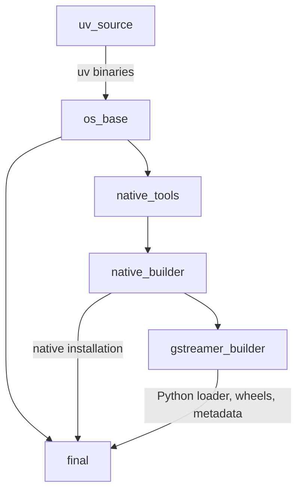

# Dockerfiles and build stages

Choose the Dockerfile explicitly. The build context is always the **repository
root**, because `COPY build-utils/...` and the bind mount used for packaging
refer to that directory. There is no Dockerfile or symlink in the repository root.

| Ubuntu | Dockerfile | Context |
|---|---|---|
| 24.04 (default) | `docker/ubuntu-24.04.Dockerfile` | repository root |
| 26.04 | `docker/ubuntu-26.04.Dockerfile` | repository root |

Just and both release entry points call [`scripts/build.sh`](../scripts/build.sh).
It validates the build options, selects the Dockerfile, and passes absolute
Dockerfile/context paths to Buildx, so the caller's working directory does not
change what is built.

```bash
# Recommended interface, run from the repository root:
just build-release ubuntu 26.04 1.28.8 base non-free runtime 3.14 0.13.5

# Direct equivalent for this variant (also run from the repository root):
docker buildx build --load --platform linux/amd64 \
  --file docker/ubuntu-26.04.Dockerfile --target final \
  --build-arg GSTREAMER_VERSION=1.28.8 \
  --build-arg GSTREAMER_BUILD_TYPE=release \
  --build-arg GSTREAMER_BUILD_PROFILE=base \
  --build-arg VARIANT=non-free \
  --build-arg PYTHON_VERSION=3.14 \
  --build-arg UV_VERSION=0.13.5 \
  --build-arg RELEASE_REVISION=1 \
  --build-arg IMAGE_VERSION=1.28.8-ubuntu.26.04-base-py-3.14-non-free \
  --build-arg SOURCE_REVISION="$(git rev-parse HEAD)" \
  --build-arg BUILD_CREATED="$(date -u +%Y-%m-%dT%H:%M:%SZ)" \
  --tag gstreamer:1.28.8-ubuntu.26.04-base-py-3.14-non-free .
```

For Ubuntu 24.04, select `--file docker/ubuntu-24.04.Dockerfile`. Do not pass
`docker/` as the context. From another directory, pass absolute paths to both
`--file` and the final context argument. The wrapper also checks that the
numeric upstream GStreamer tag exists before invoking Docker; a direct Docker
invocation bypasses that host-side preflight.

## Stage dependencies



### 1. `uv_source`: select the uv distribution

Reads `UV_VERSION` and obtains `/uv` and `/uvx` from the official uv image.
The separate stage lets `COPY --from=uv_source` use a parameterised image tag.

### 2. `os_base`: shared Ubuntu environment

Starts from the selected Ubuntu release, copies uv, and configures noninteractive
APT, unbuffered Python output and package copying from uv caches. Bash uses
`errexit` and `pipefail` so failures are not hidden by logging pipelines.
The original `DEBUGINFOD_URLS`, uv bytecode compilation and resolution policy
remain configured. No target Python or compiler toolchain is installed here. Both the build stages
and the runtime derive from this stage.

### 3. `native_tools`: build-only dependencies

Installs C/C++ compilers, source-download utilities, ccache, GLib/introspection
headers, graphics development libraries, Cairo headers and pkg-config. Package
roles are documented next to the APT installation in each Dockerfile.

[`install-python.sh`](../build-utils/install-python.sh) creates a fixed Python
3.12 environment at `/opt/buildtools`, with its interpreter under
`/opt/build-python`. Meson, Ninja, CMake and setuptools use this environment. `MESON_VERSION` has
a pinned default of `1.12.1` and can be overridden with a Docker build argument.
It stays independent of the Python selected for the final image.

The `base`/`full` profiles install GTK/Atk introspection; only `full` installs Rust and cargo-c. The non-free option installs
x264/x265 tools and headers, plus the Intel non-free media driver. The runtime
has its own conditional installation of the corresponding shared libraries.
Documentation-only Python dependencies from the previous Dockerfile (Jinja2,
Pygments and typogrify) are omitted because documentation generation is disabled.

### 4. `native_builder`: GStreamer and native plugins

Clones the requested GStreamer release into `/opt/gstreamer`, then calls
[`build-native.sh`](../build-utils/build-native.sh) for Meson setup, Ninja
compilation and installation.

- Introspection remains enabled; gst-python is disabled in this native phase.
- GstGL explicitly enables X11, Wayland, EGL and surfaceless backends; missing
  backend dependencies fail configuration instead of producing a GTK-incompatible library.
- `minimal` enables the standard plugin stack, RTSP and introspection without GTK, gst-libav or Rust.
- `base` adds GTK/Atk packages and gst-libav.
- `full` also enables Rust plugins, excluding csound.
- Non-free explicitly selects the Meson GPL option and x264/x265 plugins.
- `release` enables LTO; documentation, tests and examples are disabled.

The Meson `tests=disabled` option skips compilation of the upstream test suites.
Post-build plugin pipelines and offline venv checks run separately through
[`scripts/verify-image.sh`](../scripts/verify-image.sh).

The build directory is `/opt/gstreamer/build`. Installation uses prefix `/usr`
and `DESTDIR=/install/gstreamer`, producing a tree that can be copied into the
runtime. The same installation is also placed in the builder's `/usr` so the
next stage can discover GStreamer through pkg-config.

Compiler/Cargo cache mounts are separate for each Ubuntu release and, for
compiled outputs, architecture. Logs, source commit, Meson options, dependency
versions, timings and native-file hashes are retained under `/opt/build-metadata`.

### 5. `gstreamer_builder`: target Python, loader and wheel

Installs the requested CPython at `/opt/uv/python` and creates `/opt/uv/venv`.
`UV_TOOLCHAIN_DIR` points to the actual interpreter installation; pkg-config
uses its headers/libraries and the target environment's PyGObject headers.

[`build-python.sh`](../build-utils/build-python.sh):

1. Builds wheels for PyGObject, pycairo and typing-extensions, then installs those
   same wheels into the build environment. Pycairo is built first and reused by
   PyGObject's isolated build; a build constraint keeps its version aligned.
   Dependency wheels also follow the requested build type and enable LTO in release.
2. Builds gst-python separately against the installed GStreamer and target
   Python, including the interpreter-specific `libgstpython.so` plugin loader.
3. Packages the GStreamer Python overrides and native extensions with Hatchling;
   includes the GES override when its native typelib is installed.
4. Keeps all wheels and exact build-environment metadata in `/opt/wheel`.

The loader is staged under `/install/python/usr`; Python overrides/extensions
are installed through the wheel. PyGObject continues to own the `gi` package.
The wheel does not include the GStreamer native libraries or typelibs.

Non-release builders also retain `gdb` for debugging.

This stage is also the **dev image target**: it retains the compilers, headers,
source tree, build directories, installed bindings and staged installation.
The Cargo artifact cache is not exported; its empty target directory is retained
so the source build's Cargo symlink remains usable in dev images.
`IMAGE_TARGET=dev` selects this target through the wrapper, independently of
whether the build type is release, debug or debugoptimized.

### 6. `final`: runtime image

Starts again from `os_base` and installs shared-library dependencies, not the
compiler toolchain. The common APT list supports the standard plugin stack. GTK3/GTK4/Atk and
FFmpeg filter/fingerprinting packages are installed only outside `minimal`.
The variant separately controls x264/x265 libraries and the non-free driver.

GIRepository 3 is available in every profile and target. GTK4 and ATK typelibs
are available in runtime/dev images for `base` and `full`. X11/XCB and Wayland shared libraries support the compiled GstGL backends.
Wayland protocol XML files are build inputs and stay in the builder.

The native installation is copied from `native_builder` **before** selecting
Python. The target interpreter is then installed, followed by the matching
Python plugin loader, wheels and build metadata. Wheel installation uses
`--no-index --find-links=/opt/wheel`, so it needs neither a network nor a compiler.
Local wheel installation also bypasses uv archive caching because wheels built
for different Ubuntu versions can have identical filenames.

Keeping `/opt/wheel` in the runtime supports clean offline venv installations
and lets the release flows extract all required Python wheel artifacts.

## Why two Dockerfiles?

Ubuntu changes shared-library package names and ABI versions. For example:

| Library/API | Ubuntu 24.04 | Ubuntu 26.04 |
|---|---|---|
| FFmpeg filters | `libavfilter9` | `libavfilter11` |
| FLAC | `libflac12t64` | `libflac14` |
| VP8/VP9 | `libvpx9` | `libvpx12` |
| TagLib | `libtag1v5-vanilla` | `libtag2` |
| H.264 | `libx264-164` | `libx264-165` |
| H.265 | `libx265-199` | `libx265-215` |
| Intel video API | `libmfx1` (Media SDK) | `libvpl2` (oneVPL) |

Each Dockerfile documents the runtime codec, display, audio, transport and
introspection packages. The Meson, Python and packaging logic lives in shared
scripts under `build-utils/`; changes to the stage structure still need to be
applied to both Dockerfiles. APT removals should be checked with plugin pipelines
and missing-library checks, rather than inferred from package names alone.

## What changes invalidate the cache?

Changing the target Python rebuilds bindings and its loader, while reusing native
GStreamer. Changing wheel metadata affects the packaging step without rebuilding
GStreamer. Changing Ubuntu, GStreamer, build type, profile or non-free options can
require a new native build. The runtime native layer is shared by Python variants.

BuildKit layer-cache export/import and compiler cache mounts are distinct.
`BUILD_CACHE_FROM`/`BUILD_CACHE_TO` configure layer caches; exporting with
`mode=max` includes intermediate stages but does not persist compiler/Cargo cache
mount contents on a new CI runner. See the [main README](../readme.md#ubuntu-variants-and-build-cache)
for cache configuration.
